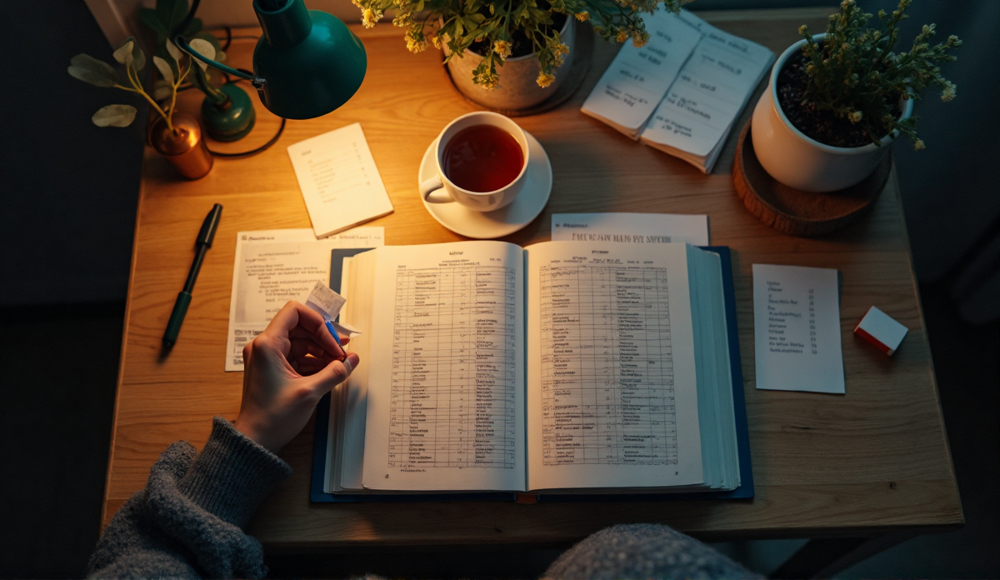

Many students hit the same wall in their first year of a nursing or medical course. By week six the pathophysiology makes sense, but the drug names blur together, and a term your lecturer uses in one breath you can only spell backwards in the exam.

That wall is what this post is for. A list of several hundred terms is not a list you will type into boxes by hand, so the app question is real: what is each one built to do, what does it cost, and which one fits a student with a huge term list and a part-time job? The prices below are US figures checked in November 2026; your country's store will show different numbers.

## Is Anki the best app for memorising medical terminology?

For a big terminology list, Anki is the strongest free choice: its scheduler is tunable, you set the recall rate you want, and it runs free on desktop, Android and the web. Brainscape is the pick when you want a ready-made, expert-checked deck for a standard exam like the NCLEX or MCAT. Quizlet and Cram are the easiest starts, useful when the exam is close and you want cards in two minutes.

A photo-to-cards route like SnapDeck AI's builds your own deck quickly from a page or a PDF. It is one route among several. The rest of this post breaks down what each app does and what it costs.

The short answer to the title: yes, if you are studying for months and will set up a deck; no, if you need cards tonight and the typing is the part you put off. All four of the big apps run on the same two mechanisms. Retrieval practice is the engine: Roediger and Karpicke showed in 2006 that testing yourself beats re-reading. For a term list, the app's job is to make you recall fast, at the right moments, without you running the schedule yourself.

The spacing effect, reviewed by Cepeda and colleagues in 2006, says the same material is remembered better when reviews are spread out than crammed. [The mechanics behind that](/blog/active-recall-explained/) are what the schedulers in Anki, Brainscape, Cram and Quizlet automate for you.

**Anki** is the reference point for this job. The scheduler does the maths: you set the recall rate you want and it schedules the reviews, and the scheduling has been tunable by enthusiasts for years. It is free on Windows, Mac, Linux and Android, with free sync through AnkiWeb, and the iPhone and iPad app, AnkiMobile, is a one-time $24.99. Images, audio and reverse cards are included at no extra cost, which matters when a term is a structure with a labelled diagram.

The trade-off is setup. Building a deck by hand, or learning enough of Anki's quirks to import one cleanly, is a project. Shared decks on AnkiWeb vary in quality, so check the author and the update date before you trust one. See [the head-to-head of these apps](/blog/best-flashcard-apps/) for the longer version of this comparison.

## The rest of the field

**Quizlet** is one of the most widely known names in this list and the easiest start. You can make and flip your own sets free, and there is a large library of decks other people have built. The free plan caps the modes that actually test you, Learn and practice tests, and the paid tiers remove those caps.

In the US, Quizlet Plus runs $35.99 a year, with a more permissive Plus Unlimited tier at $44.99. Pre-made decks are convenient but unchecked, and labelled diagram sets sit behind the paid tier. For a term list you have to build from your own course, Quizlet works, and you are paying mostly to unlock testing modes rather than to skip the work of making cards.

**Cram** went a different direction. Its AI is the point: paste text or upload a PDF and it generates flashcards and quiz questions. The free tier gives you a small number of AI-generated sets per day (three, per its store listing), plus unlimited reviews, spaced repetition and streaks. Cram Premium, $9.99 a month or $59.99 a year at the Android store price, removes the generation cap. If your material arrives as notes and PDFs and you want cards without retyping anything, this is the shortest distance between the two.

**Brainscape** is the one with one of the deepest libraries for exactly these courses. Its expert-certified decks cover the NCLEX, the MCAT and other nursing and medical exams. It runs on a confidence rating: after each card you mark how sure you were, 1 to 5, and the scheduler does the rest. Creating and studying unlimited text cards of your own is free, and a decent allotment of AI card generation and decks shared with you come with it.

Pro, from $7.99 a month billed yearly, unlocks the certified library without limits, image cards and privacy controls. If you are sitting a standard exam and a vetted deck would save you a week, this is the one.

## The photo-to-cards route

The fifth option skips the typing entirely. SnapDeck AI turns a photo of a textbook page, a handout or a PDF into a question-and-answer deck in seconds, on the device: no account, nothing uploaded, free for up to 3 decks a month with a one-time Premium purchase that removes the caps.

It needs iPhone 15 Pro or later with iOS 26 and Apple Intelligence enabled, which rules some readers out. Index cards you write by hand still work, and they work anywhere.

What a photo-to-cards path saves is the evening you would have spent transcribing, so the same material ends up reviewed the same night. Its study mode is flip cards plus your own progress marking; you are the one who decides to space the reviews across days, the way the spacing effect wants. It makes text question-and-answer cards only, so for a labelled diagram use Anki or paper cards.

## A worked example: one week before a pharmacology paper

Say your course is one week from a pharmacology paper and you have roughly 200 drug terms with their class, mechanism and the one side effect that gets asked about. Here's what a week looks like on a free setup, and you can do this on Anki, Brainscape, or by hand.

**Day 1, the split.** Break the 200 into five decks of 40 by drug class, since a class-sized deck is something you can review in one sitting. Five decks, five build evenings.

**Days 2 to 6, the build.** Each evening, build the next deck of 40, then from Day 3 start by re-testing the previous evening's deck for five minutes before you build. Front: a clinical clue or the mechanism. Back: the drug's name, plus the exam side effect. One fact per card. Write the mechanism in your own words, since rephrasing is where the learning happens.

If you used a photo-to-cards tool for the first pass, spend the session on the cards that came out wrong, and fix the ones that sound plausible but are off.

**Day 7, the purge and the gaps.** Do one full pass over all five decks. Then cut a card only if you got it right on this pass and on its earlier re-test. Decks 1 to 4 each had that earlier re-test, so you can cut from them.

Deck 5, built on Day 6, has had no earlier re-test, so keep its cards for another day. The deck that survives is your real exam deck, and the blanks in it are your study targets. End with the class list itself: name every diuretic in the first three minutes, from memory. The blanks you leave are the ones you still need.

While you build, also make a few cards on the word parts, the prefixes, suffixes and roots that carry meaning: 'cardio-', '-itis', '-ectomy'. A card that says what '-emia' means will save you more than any single drug card, because it pays off across every term that uses the root. And if a shared deck on AnkiWeb matches your course, vet the author and the update date first, then keep only the cards your own course uses.

The week above costs about three hours in total, including the short re-tests. Re-reading the chapter instead would leave you recognising the terms rather than recalling them, which is the difference that shows up in the exam.

## What should I pay for, if anything?

Start with the free tier, seriously. The pattern across every paid tier on this list is the same: the free plan covers the start of a course, and the paywall bites when you want more AI generation, more ready-made expert content, offline or ad-free use, or image cards. A subscription for one exam is only worth it if the deck it unlocks saves you real time, because a one-time purchase you keep for the next course is the better deal when the deck is not the point.

Three rules, in order of usefulness:

1. **Pay for the deck rather than the app.** If a ready-made, expert-checked deck exists for your exam and it's good, the subscription that unlocks it is worth it. That is Brainscape's actual selling point.
2. **Pay to skip the typing only if the volume is real.** A few hundred terms a month is a lot to transcribe; a few dozen is within one evening's reach.
3. **Don't pay for a scheduler you can already get free.** Anki's is free on every platform except the one-time AnkiMobile purchase on iPhone and iPad.

And the rule that outperforms the pricing page: the best app is the one you open on a tired evening. An app you open every day beats a more powerful one you abandon by week two.

## Bottom line

Terminology is a volume problem, and a good week of building cards is a way of handling that volume. The mechanism is the same across every option on this list: recall instead of recognition, spread over time, with the cards getting fewer as you get better.

Pick the route that gets you to the first review session fastest, and give it a week before you judge it. If the week works, the choice has made itself. [The general method for packing a lot of material into a short window](/blog/memorise-material-fast/) is the same one, just without the exam-room vocabulary.
