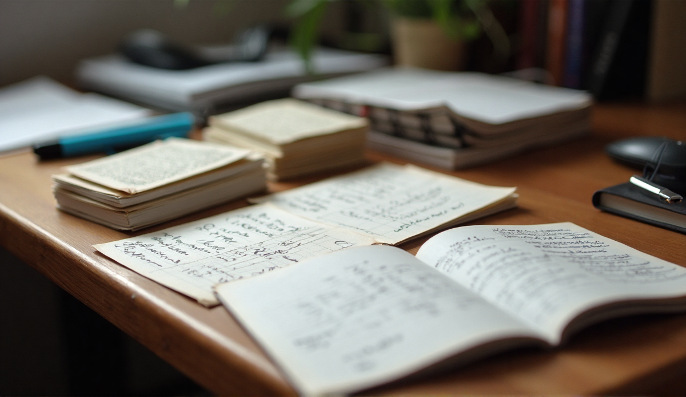

You pulled an all nighter before a chem exam. At 4am you could recite every slide, every definition, every diagram, and it felt like you knew the whole paper. At 9am the questions opened, and you could not solve one problem. Not because you forgot — you had not forgotten — but because recognising a slide at 4am and applying it under time at 9am are two different skills, and the all nighter only built the first one.

Most of us were never taught when to start, only what to learn. So the start date becomes a mystery, and most students guess: a week out, two weeks out, the night before, all of it with the same uneasy feeling that the real answer is a number they have not been given.

## How long before an exam should you start revising?

Several weeks out, for a big exam, and much less for smaller assessments — but the start date is the least important part of the answer. What matters is the number of separate passes you fit in, and the gaps between them.

A practical test: **start once the material has stopped being new.** That is sooner than it feels. Once you have been through the material once — lectures attended, chapters read — it has stopped being new, and the first pass, the one that turns it into questions, can start straight away. If you have not met the material yet, a first read counts as the start. The spacing effect — the finding that the same material reviewed across separated sessions sticks better than a massed review, reviewed by Cepeda and colleagues in 2006 — is why the gap matters more than the date.

The exact number depends on the exam, the subject and the person. A first-year facing a dense first exam needs more lead time than a final-year facing a paper they have been revising all term. Coursework and continuous assessment change the shape of the problem, because part of the exam is spread across the term instead of sitting at the end of it. If your exams come in a block at the end of term, the block is the unit to plan around; if they come one by one, each one is its own mini-schedule.

## Why does starting earlier help if you study the same total hours?

Because earlier buys you gaps, and gaps are what make the material stick.

Ebbinghaus's forgetting curve is the idea that most of the forgetting happens fast, in the first day or two after you learn something, and then tapers. A single long session the night before sits entirely inside that fast drop. A session a week before, with a retrieval pass the day after, sits on the slow tail: the material is fading when you come back, so the retrieval is doing real work, not just recognition.

This is also why spaced revision *feels* worse: Bjork called the effort of retrieving something that is partly faded a desirable difficulty, because that very effort is what strengthens the memory, and it is also the thing that feels unpleasant. A massed session feels smooth and productive, and that smoothness is the warning sign. The testing effect, the finding that taking a memory test improves long-term retention relative to more time spent studying the same material, is what makes the retrieval pass worth its place in the schedule.

## What does a revision schedule look like by lead time?

The structure is the same at every lead time: four passes, in this order. What changes is the size of the gaps — the more weeks you have, the more they can open up.

### Plenty of time (many weeks out)

This is the case most students are in, and it is the case the schedule is easiest to get right.

- **Pass one: first contact.** Work through the material at reading speed. Your job here is to turn it into questions, not to take better notes. If a page does not produce a question you can answer from memory later, you are still reading, not revising. This is also the pass where the manual work is highest, because you are turning slides, notes or textbook pages into question-and-answer cards by hand. A pen and index cards will do this just fine and cost nothing, and a free flashcard app works too. A photo-to-cards tool saves the typing time on this first pass: a tool like [SnapDeck AI](/blog/best-flashcard-apps/) photographs a page and returns question-and-answer cards in seconds, so you can spend the saved time actually working the cards instead of writing them. It runs on-device, needs iPhone 15 Pro or later with iOS 26 and Apple Intelligence enabled, and nothing leaves the phone. None of it changes the rest of the plan — the spacing is still the thing you do, and it schedules nothing.
- **Pass two: retrieval.** A few days later, work the cards from memory only. The ones you get wrong are the ones to keep.
- **Pass three: mixed practice.** A week or two later, mix this subject's material with another, or mix the topics inside one subject. Interleaving, the finding that switching between related topics beats studying one block of one topic, is where this pass earns its place.
- **Pass four: light review.** A few days before the exam, skim the cards you got wrong in pass three. This pass is short on purpose.

### A few weeks out

Same four passes, compressed. The gaps are shorter but still real — at least a day between pass one and pass two, and a day or two between each of the rest. Pass four shrinks to the wrong-answer cards only. If the material is already familiar, you can drop pass one to a quick skim and keep the other three.

### Days out

Two passes with a night's sleep between them. Sleep helps consolidate what you just studied — it is the one part of the all-nighter trade you should not lose — and the second pass is where you test the material the first pass only surfaced. Cut scope by dropping the lowest-weight topics, not by shortening the sleep. If you are behind across the board, [the triage in catch-up-semester-notes](/blog/catch-up-semester-notes/) is how to decide what to drop, and the sleep is the one part you do not trade away.

**A worked example.** One exam, a topic-heavy paper, the Monday roughly three weeks out. Pass one starts the Wednesday of this week, turning the notes into questions. Pass two is the Sunday of the same week, four days later. Pass three is the Sunday of the following week, a week later. Pass four is the Friday of the week before the exam, a short pass over the wrong-answer cards only. If a gap feels too short at any point, drop a topic from a later pass rather than compressing the gap — the gap is the part doing the work.

## What if the syllabus is unclear or keeps changing?

Start from the parts that are stable. Most courses have a core that does not move, even when the edges shift. Work the core in pass one, and mark the rest as provisional. Re-check the syllabus at fixed points — after each lecture, or once a week — and only fold a new topic into the passes once it is confirmed.

How fixed a syllabus is varies a lot by course and country, so this is not a one-size answer. A course that hands out the topic list at the start of the term lets you plan all four passes up front. A course that releases topics as it goes needs you to leave room in the schedule for the new topics to land, and to let pass one keep absorbing them rather than freezing. Do not wait for certainty before the first pass — the first pass on a provisional topic is still useful, because the questions you wrote for it will still be the right questions once the topic is confirmed.

## Is it too late to start if the exam is next week?

It is late, and the goal changes. You are no longer covering the whole syllabus; you are owning the highest-weight topics. Two passes, with a night's sleep between them, is still better than one all-nighter, and it costs the same hours. Cut the low-weight material, not the sleep. You will not walk in having seen everything, but you will walk in having *retrieved* the topics most likely to come up, and that is a different starting position than the all-nighter.

## The short version

- Start several weeks out for a big exam, less for a smaller one. The exact date matters less than the passes.
- Plan four passes with gaps between them, and use the weeks you have to open the gaps up.
- Sleeping between passes is part of the plan, not a failure of it.
- A late start changes the goal, not the fact that spacing still beats massing.

The next step is putting those passes on a calendar that survives your actual week. [The timetable post](/blog/revision-timetable-that-works/) covers how to build one. Start earlier than feels necessary, and let the gaps do the heavy lifting.
